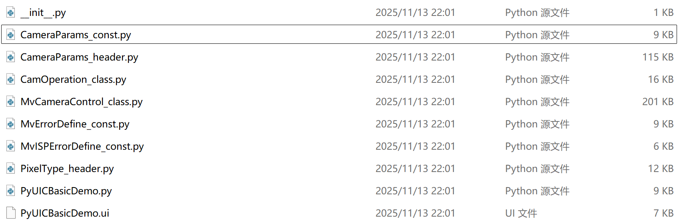

# README
相机驱动及相关依赖

## 依赖（相机驱动）
MVS官网下载"工业相机客户端"
使用python打开相机
参考[网址](https://www.cnblogs.com/yfceshi/p/19036002)

## 注意事项
1. 此处几个python文件为相机驱动，请勿删除，且需要与 `CCD_Track.py` 同放在 `Detect/Camera` 目录下
文件来源目录：D:\Softwares\MVS\MVS\Development\Samples\Python\MvImport

2. 运行 `Detect/Camera/BasicDemo.py`，能够设置相机参数
文件来源目录：D:\Softwares\MVS\MVS\Development\Samples\Python\AreaScanCamera\BasicDemo.py
曝光、增益、触发方式等

3. `Detect/Camera/CCD_Track.py` 连续采集方式，实现摄像头数据采集
该程序根据例程 BasicDemo.py 更改的
运行 UAV_Detect.py 时，会自动调用该程序

4. 运行 `Detect/UAV_Detect.py`，能够实现相机数据采集与目标检测
详细内容参考 README_TRACK.md