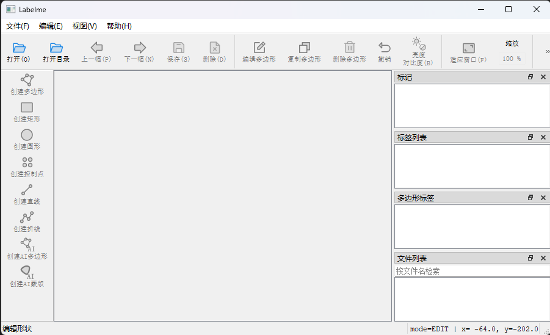
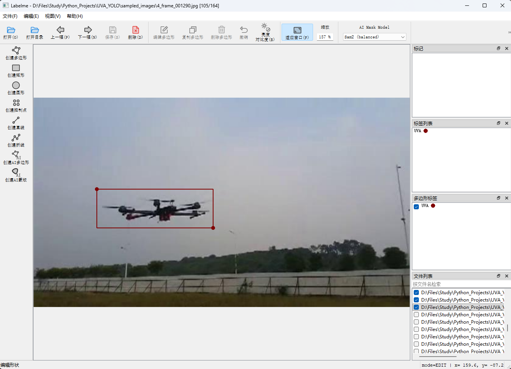
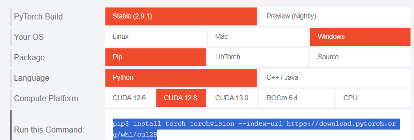
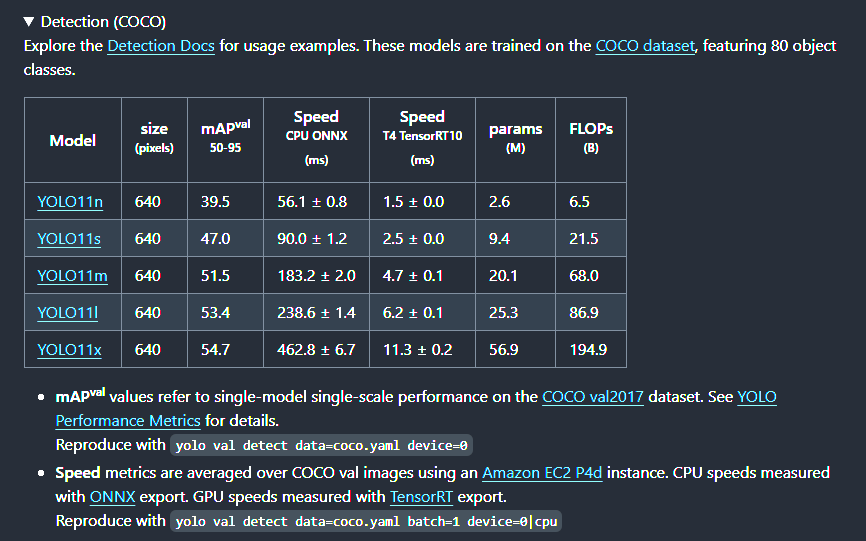
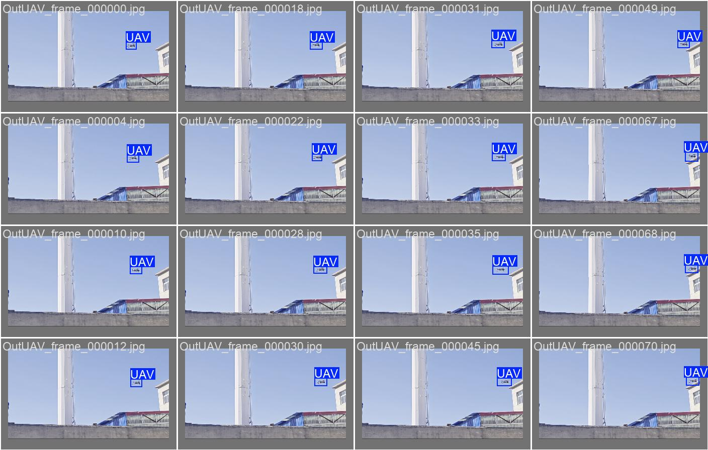

# README
模型训练及测试


## 准备数据集
将视频间隔采样转为图片，使用 `Train/video_sample_image.py` 采样 `videos` 中的视频，并保存为图片到 `sampled_images` 文件夹下。

## 标注

1. 安装标注工具
    ```bash
    pip install labelme
    ```

2. 启动标注工具
    ```bash
    labelme
    ```
    

3. 开始标注
    打开目录->选择待标注的文件夹（CCD_Images文件夹）->显示文件夹中的图像->创建矩形->框选物体->设置标签->保存->下一幅
    
    > **TIPS：** 可以勾选`文件->自动保存`自动保存标注


4. 转换数据集
    `labelme` 标注后生成了`json`文件，需要转换成`yolo`格式，使用 `Train/lebelme2YOLOlabel.py` 转换，生成 YOLO 数据集目录 `CCD_UAVdataset`。


## 训练

### 安装 ultralytics:

```bash
pip install ultralytics
```

### 安装 pytorch:

**方法一：安装CUDA版本（训练速度快，体积巨大）**
首先查看显卡版本：

```bash
nvidia-smi
```

显示如下：

```bash
+-----------------------------------------------------------------------------------------+
| NVIDIA-SMI 572.83                 Driver Version: 572.83         CUDA Version: 12.8     |
|-----------------------------------------+------------------------+----------------------+
| GPU  Name                  Driver-Model | Bus-Id          Disp.A | Volatile Uncorr. ECC |
| Fan  Temp   Perf          Pwr:Usage/Cap |           Memory-Usage | GPU-Util  Compute M. |
|                                         |                        |               MIG M. |
|=========================================+========================+======================|
|   0  NVIDIA GeForce RTX 4060 Ti   WDDM  |   00000000:01:00.0  On |                  N/A |
|  0%   56C    P0             35W /  165W |    2483MiB /  16380MiB |      7%      Default |
|                                         |                        |                  N/A |
+-----------------------------------------+------------------------+----------------------+
```

此处的CUDA版本为12.8
进入[网址](https://pytorch.org/)
选择你的电脑配置，复制命令安装PyTorch



**方法二：安装CPU版本（训练速度慢，体积小）**

```bash
pip3 install torch torchvision
```

### 开始训练

`Train/train.py` 脚本用于训练模型。生成的模型是 `yolo_CCDUAV_training\CCDUAV_detection\weights\best.pt` 。
这里用的是 yolo11n 预训练模型，也可以用 yolo11m 模型， yolo11m 的能力更强，但检测速度会慢。模型位于 `model` 文件夹下。
下载地址： https://github.com/ultralytics/ultralytics
如图，点击下载


### 测试

`Train/eval.py` 脚本用于测试模型，测试结果会保存在工程根目录的 `runs\detect` 文件夹中。


## 使用

问 DeepSeek


## 其他

其他依赖直接使用 pip 安装